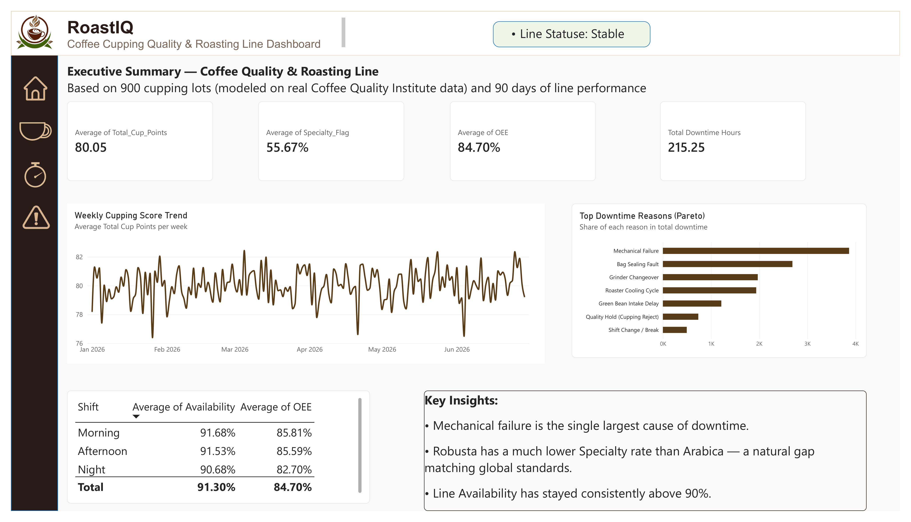
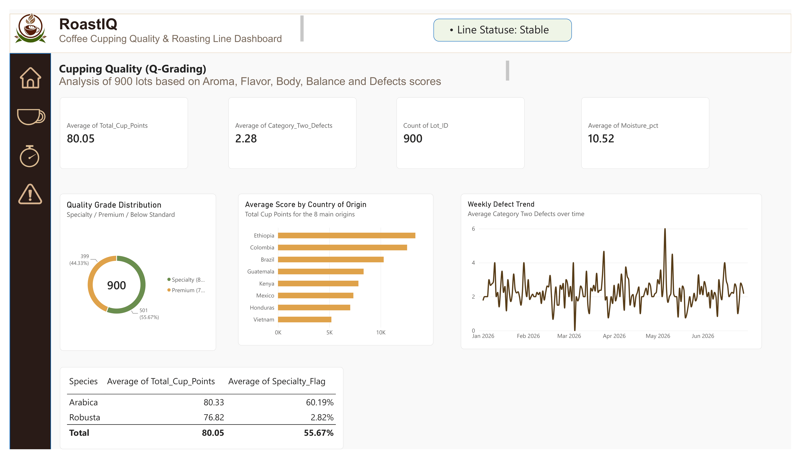
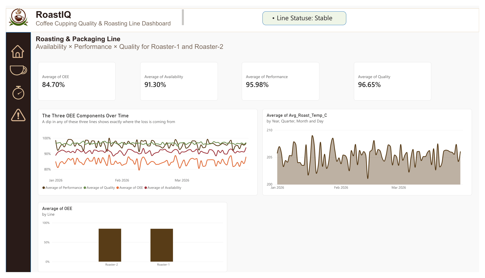
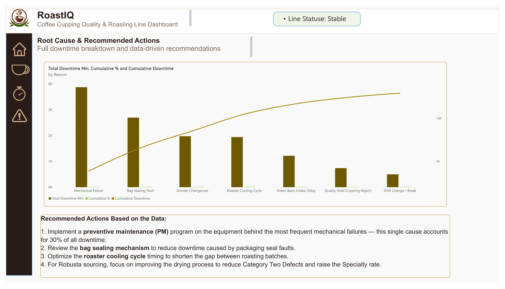

# ☕️ RoastIQ — Coffee Quality & Roasting Line Dashboard (Power BI)

A management dashboard built in Power BI to monitor coffee cupping quality (based on the official Q-Grading system) and roasting/packaging line performance — combining real-world food science QC standards with Star Schema data modeling and DAX.

## ☕️ Overview

This project applies the Coffee Quality Institute's (CQI) Q-Grading system — the same cupping methodology used by specialty coffee roasters worldwide — to a Power BI dashboard, paired with roasting-line efficiency metrics (OEE). It tracks both product quality (sensory cupping scores per lot) and production efficiency side by side.

The dashboard has 4 pages, connected through a custom icon-based sidebar for navigation:

| Page | What it shows |
|---|---|
| Executive Summary | Avg. Total Cup Points, Specialty Rate, OEE, Total Downtime, weekly score trend, downtime Pareto, shift comparison, key insights |
| Cupping QC | Quality grade distribution, score by country of origin, defect trend, Arabica vs. Robusta comparison |
| Roasting Line | Availability × Performance × Quality breakdown over time, roasting temperature stability, Roaster-1 vs. Roaster-2 comparison |
| Root Cause | Full Pareto analysis (bar + cumulative % line) of downtime reasons, data-driven recommended actions |

## 🖼️ Screenshots

*(Replace the file names above with your actual uploaded screenshot names)*

## 📈 Key KPIs & DAX Measures

| KPI | Formula |
|---|---|
| Total Cup Points | Sum of 10 sensory scores (Aroma, Flavor, Body, Balance, etc.) minus defect penalty |
| Specialty Rate | Average of Specialty_Flag (lots scoring 80+) |
| OEE | Availability × Performance × Quality |
| Total Downtime Hours | SUM(Fact_Downtime[Duration]) / 60 |
| Downtime Pareto | Cumulative % via RANKX + CALCULATE |

`DAX
Total Downtime Min = SUM(Fact_Downtime[Duration])

Reason Rank = RANKX(ALL(Fact_Downtime[Reason]), [Total Downtime Min], , DESC)

Cumulative Downtime = 
VAR CurrentRank = [Reason Rank]
RETURN
CALCULATE(
    [Total Downtime Min],
    FILTER(ALL(Fact_Downtime[Reason]), [Reason Rank] <= CurrentRank)
)

Cumulative % = 
DIVIDE([Cumulative Downtime], CALCULATE([Total Downtime Min], ALL(Fact_Downtime[Reason])))
